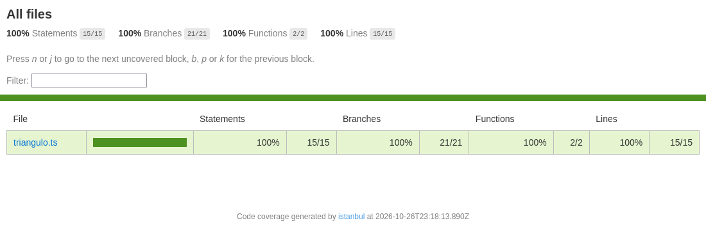
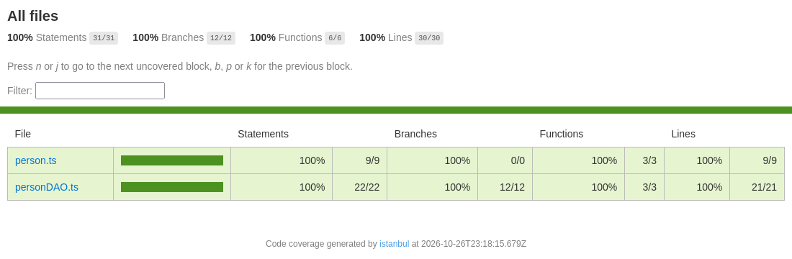
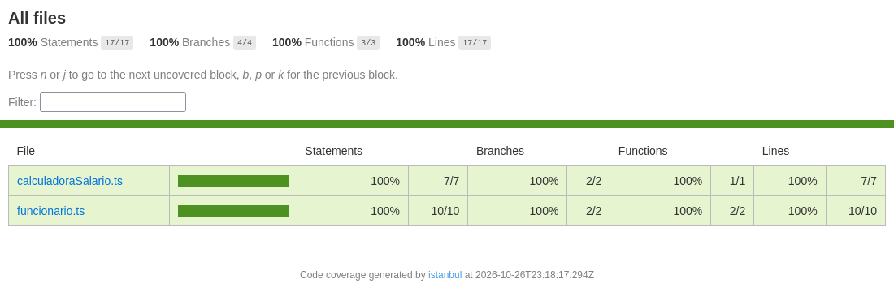

# Exercícios Práticos de TDD — LAB V 5BD (FATEC/SJC)

TypeScript com Jest.

## Build

```bash
npm install
npm run build
```

## Execução dos testes

```bash
npm test
```

Com cobertura de código:

```bash
npm run coverage        # todos os exercícios
npm run coverage:ex1    # Exercício 1
npm run coverage:ex2    # Exercício 2
npm run coverage:ex3    # Exercício 3
```

O relatório HTML é gerado em `coverage/index.html`.

## Evidências de cobertura

### Exercício 1 — Triângulo

```
$ npm run coverage:ex1
--------------|---------|----------|---------|---------|-------------------
File          | % Stmts | % Branch | % Funcs | % Lines | Uncovered Line #s
--------------|---------|----------|---------|---------|-------------------
All files     |     100 |      100 |     100 |     100 |
 triangulo.ts |     100 |      100 |     100 |     100 |
--------------|---------|----------|---------|---------|-------------------
Tests:       27 passed, 27 total
```



### Exercício 2 — isValidToInclude()

```
$ npm run coverage:ex2
--------------|---------|----------|---------|---------|-------------------
File          | % Stmts | % Branch | % Funcs | % Lines | Uncovered Line #s
--------------|---------|----------|---------|---------|-------------------
All files     |     100 |      100 |     100 |     100 |
 person.ts    |     100 |      100 |     100 |     100 |
 personDAO.ts |     100 |      100 |     100 |     100 |
--------------|---------|----------|---------|---------|-------------------
Tests:       20 passed, 20 total
```



### Exercício 3 — Calculadora de salário

```
$ npm run coverage:ex3
-----------------------|---------|----------|---------|---------|-------------------
File                   | % Stmts | % Branch | % Funcs | % Lines | Uncovered Line #s
-----------------------|---------|----------|---------|---------|-------------------
All files              |     100 |      100 |     100 |     100 |
 calculadoraSalario.ts |     100 |      100 |     100 |     100 |
 funcionario.ts        |     100 |      100 |     100 |     100 |
-----------------------|---------|----------|---------|---------|-------------------
Tests:       16 passed, 16 total
```


